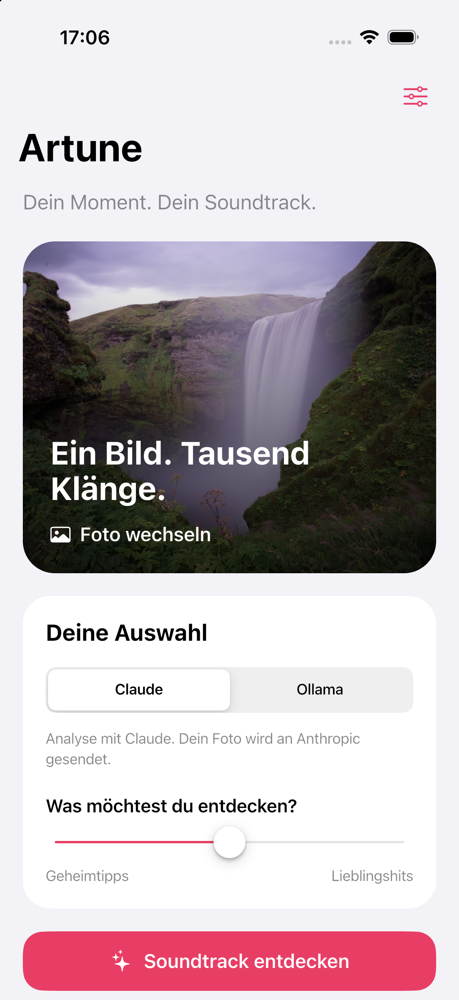
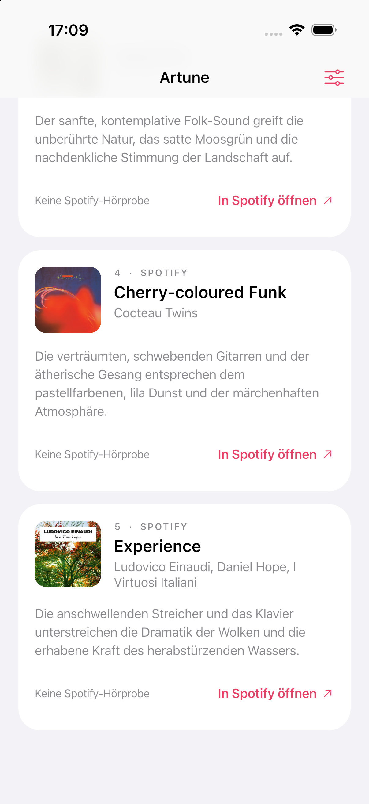

<div align="center">

# Artune

### Dein Moment. Dein Soundtrack.

Ein nebliger Wasserfall. Ein Sonnenuntergang. Ein Bild, das nach Musik klingt.

**Artune findet die Songs dazu.**

[Entdecken](#so-funktionierts) · [Loslegen](#in-wenigen-minuten-startklar) · [Ollama nutzen](#lieber-lokal-ollama) · [Entwicklung](#entwicklung)


</div>

<br>

<table>
  <tr>
    <td align="center" width="50%"></td>
    <td align="center" width="50%"></td>
  </tr>
  <tr>
    <td align="center"><strong>Ein Bild. Tausend Klänge.</strong><br>Wähle deinen Moment und deinen KI-Anbieter.</td>
    <td align="center"><strong>Musik, die wirklich existiert.</strong><br>Im Spotify-Katalog gefunden, direkt zum Anhören öffnen.</td>
  </tr>
</table>

<sub>Echte Aufnahmen der App im iPhone-17-Pro-Simulator. Cover und Songdaten stammen von Spotify.</sub>

## So funktioniert’s

1. **Moment auswählen.** Lade ein Foto aus deiner Mediathek.
2. **Sound bestimmen.** Wähle Claude oder Ollama und entscheide zwischen Geheimtipps und bekannten Hits.
3. **Musik entdecken.** Die KI schlägt Songs zur Stimmung, Farbwelt und Atmosphäre des Bildes vor. Artune sucht diese anschließend im echten Spotify-Katalog.
4. **Reinhören.** Spiele verfügbare Hörproben ab oder öffne den Titel direkt in Spotify.

### Was drinsteckt

- **iOS-Oberfläche:** große Titel, native Cupertino-Bedienelemente und klare Karten.
- **Zwei KI-Anbieter:** Claude über die API oder ein eigener Ollama-Server mit Vision-Modell.
- **Echte Spotify-Treffer:** abgeglichene Titel und Künstler, Albumcover und direkte Track-Links. Vorschläge ohne passenden Treffer werden ausgefiltert.
- **Ein Player:** Play/Pause und Fortschrittsanzeige für verfügbare Spotify-Hörproben. Es spielt immer nur ein Song gleichzeitig.
- **Bewegung mit Gefühl:** eine rotierende Schallplatte mit deinem Foto und ein animierter Equalizer während der Suche. Die Animation berücksichtigt reduzierte Bewegung.
- **Verbindung im Blick:** konfigurierbare Serveradresse, Verbindungstest und verständliche Fehler.

> **Zu den Hörproben:** Spotify liefert nicht für jeden Titel eine `preview_url`. Das Feld ist [veraltet und kann leer sein](https://developer.spotify.com/documentation/web-api/reference/search). In diesem Fall bleibt der Song sichtbar und kann über „In Spotify öffnen“ aufgerufen werden. Eine Spotify-Suche garantiert keine Hörprobe.

## In wenigen Minuten startklar

### Voraussetzungen

- Flutter passend zur SDK-Vorgabe in [`pubspec.yaml`](music_recommender/pubspec.yaml), Python 3.10 oder neuer.
- Für den iOS-Simulator: macOS, Xcode, installierte Simulator-Runtime und CocoaPods. Das iOS-Deployment-Target ist **15.0**.
- Eine Spotify-Developer-App mit **Client-ID und Client-Secret** sowie gültigem Web-API-Zugriff.
- Für Claude: ein **Anthropic API-Key** mit Modellzugriff und API-Guthaben.
- Für Ollama: ein erreichbarer Ollama-Server und ein installiertes Vision-Modell. Docker ist optional und wird für Claude nicht benötigt.

### 1 · Backend vorbereiten

Im Projektverzeichnis:

```bash
cd imageAnalyzer
python3 -m venv .venv
source .venv/bin/activate
python -m pip install -r requirements.txt
cp .env.example .env
```

Den letzten Befehl nur bei der Ersteinrichtung ausführen, wenn noch keine `.env` existiert. Trage deine Zugangsdaten in `imageAnalyzer/.env` ein:

```dotenv
ANTHROPIC_API_KEY=dein_anthropic_api_key
CLAUDE_MODEL=claude-sonnet-5-5

SPOTIFY_CLIENT_ID=deine_spotify_client_id
SPOTIFY_CLIENT_SECRET=dein_spotify_client_secret
SPOTIFY_MARKET=DE

PORT=8001
OLLAMA_HOST=http://127.0.0.1:11434
OLLAMA_MODEL=llama3.2-vision:11b
```

Spotify-Zugangsdaten werden für **beide** KI-Anbieter gebraucht. Der Anthropic-Key wird nur bei Auswahl von Claude verwendet. Schlüssel bleiben im Backend und gehören nicht in die Flutter-App oder ins Git-Repository.

```bash
.venv/bin/python api_server.py
```

Der Server läuft unter `http://127.0.0.1:8001`. Die interaktive API-Dokumentation findest du unter `http://127.0.0.1:8001/docs`.

### 2 · App starten

In einem zweiten Terminal, wieder vom Projektverzeichnis aus:

```bash
cd music_recommender
flutter pub get
flutter devices
flutter run -d <device-id>
```

Ersetze `<device-id>` durch die ID deines iPhone-Simulators aus `flutter devices`.

### 3 · Verbinden & entdecken

Öffne die Einstellungen über das Regler-Symbol oben rechts und wähle **„Speichern & Verbindung prüfen“**.

| Gerät | Serveradresse |
| --- | --- |
| iOS-Simulator auf dem Mac | `http://127.0.0.1:8001` |
| Echtes iPhone im gleichen WLAN | `http://<wlan-ip-deines-macs>:8001` |

Auf einem echten iPhone bezeichnet `127.0.0.1` das iPhone selbst. Nutze dort die WLAN-Adresse des Macs und erlaube bei Bedarf den lokalen Netzwerkzugriff. Der Server muss erreichbar sein; Firewall und WLAN dürfen die Verbindung nicht blockieren.

Alternativ lässt sich die Standardadresse beim Start vorgeben:

```bash
flutter run --dart-define=API_BASE_URL=http://192.168.1.10:8001
```

Eine bereits in den App-Einstellungen gespeicherte Adresse hat Vorrang.

## Lieber lokal? Ollama

Mit der mitgelieferten Docker-Konfiguration, vom Projektverzeichnis aus:

```bash
docker compose up -d
docker compose exec ollama ollama pull llama3.2-vision:11b
```

Docker Desktop muss dafür laufen. Der Modelldownload ist nur einmal erforderlich; die Modelldaten bleiben im Docker-Volume gespeichert. Das Vision-Modell benötigt mehrere Gigabyte Speicher und lokale Analysen können deutlich länger dauern als ein API-Aufruf.

Danach das Backend starten und in Artune auf **Ollama** umschalten. Ein anderes bildfähiges Modell lässt sich über `OLLAMA_MODEL` einstellen; für einen anderen Server passe `OLLAMA_HOST` an.

Wenn Ollama direkt auf dem Mac installiert ist, reicht ein laufender Ollama-Server mit dem gewählten Modell. Docker wird dann nicht benötigt.

> Bei Claude wird dein Bild zur Analyse an Anthropic gesendet. Bei Ollama wird es an den konfigurierten Ollama-Server gesendet. Die anschließende Spotify-Suche übermittelt Songtitel und Künstler, kein Foto.

## Unter der Haube

```text
Foto aus der Mediathek
          │
          ▼
     FastAPI-Backend
          │
          ├── Claude API
          └── Ollama Vision
                  │
                  ▼
         Songvorschläge mit Begründung
                  │
                  ▼
         Spotify-Suche & Trefferabgleich
                  │
                  ▼
       Cover · Songdaten · Link · optionale Hörprobe
```

Bilder werden vor der Analyse validiert, auf maximal 1568 × 1568 Pixel verkleinert und als JPEG aufbereitet. Das Backend akzeptiert Uploads bis 15 MB.

### API

| Methode | Pfad | Zweck |
| --- | --- | --- |
| `GET` | `/health` | Erreichbarkeit und Artune-Servicekennung prüfen |
| `POST` | `/predict/` | Foto analysieren und passende Spotify-Tracks suchen |

`/predict/` erwartet `multipart/form-data`:

| Feld | Typ | Bedeutung |
| --- | --- | --- |
| `image` | Datei | Das zu analysierende Bild |
| `target_popularity` | Ganzzahl, 0–100 | Präferenz von unbekannt bis Mainstream, kein exakter Spotify-Score |
| `provider` | `claude` oder `ollama` | KI-Anbieter; Standard ist `claude` |

Die Antwort enthält `message` und `recommendations`. Bei Erfolg lautet `message` `Success`; jeder Treffer enthält unter anderem `song_name`, `artist`, `reason`, `spotify_id`, `spotify_url`, `artwork_url` und die optionale `preview_url`. Fachliche Fehler werden derzeit ebenfalls mit HTTP 200 und einer erklärenden `message` zurückgegeben; deshalb immer die Antwort auswerten.

### Projektstruktur

```text
artune/
├── README.md
├── compose.yaml                  # Optionaler Ollama-Container
├── docs/screenshots/             # Aufnahmen der App
├── imageAnalyzer/
│   ├── api_server.py             # FastAPI und KI-Anbieter
│   ├── spotify_catalog.py        # Spotify-Suche und Trefferabgleich
│   ├── .env.example              # Konfigurationsvorlage ohne Schlüssel
│   └── tests/                    # Backend- und Katalogtests
└── music_recommender/
    ├── lib/main.dart             # App, Verbindung und Wiedergabe
    ├── lib/widgets/              # Songkarten und Suchanimation
    └── test/                     # UI-Tests
```

## Entwicklung

Backend-Tests, vom Projektverzeichnis aus:

```bash
cd imageAnalyzer
.venv/bin/python -m unittest discover -s tests -v
```

Flutter-Prüfungen in einem separaten Terminal:

```bash
cd music_recommender
flutter analyze
flutter test
```

Die automatisierten Anbieter- und Spotify-Tests verwenden simulierte Antworten und benötigen keine echten API-Aufrufe.

### Wenn etwas hakt

| Symptom | Was hilft |
| --- | --- |
| Keine Verbindung oder falscher Server | Adresse und Port **8001** in der App prüfen; Backend starten und Verbindungstest ausführen. |
| Nach einer `.env`-Änderung bleibt der Fehler | Backend beenden und neu starten. Bereits gesetzte Prozess-Umgebungsvariablen haben Vorrang vor `.env`. |
| Claude lehnt die Anfrage ab | Die konkrete Meldung in App und Serverlog prüfen: Modellzugriff, API-Guthaben und Schlüssel. |
| Spotify verweigert den Zugriff | Client-ID, Secret und Zugriff der Developer-App prüfen. Aktuelle [Spotify-Voraussetzungen](https://developer.spotify.com/documentation/web-api/tutorials/february-2026-migration-guide) beachten. |
| Keine Hörprobe | Spotify liefert für diesen Treffer keine Vorschau. „In Spotify öffnen“ verwenden. |
| Ollama nicht erreichbar | Server bzw. Docker starten; `OLLAMA_HOST` und installiertes Vision-Modell prüfen. |
| `.env` wird weiter von Git verfolgt | `.gitignore` wirkt nicht rückwirkend. Mit `git rm --cached -- imageAnalyzer/.env` aus dem Index nehmen; die lokale Datei bleibt erhalten. Bereits veröffentlichte Schlüssel ersetzen. |

---

<div align="center">

**Artune — finde den Sound zu deinem Moment.**

</div>
